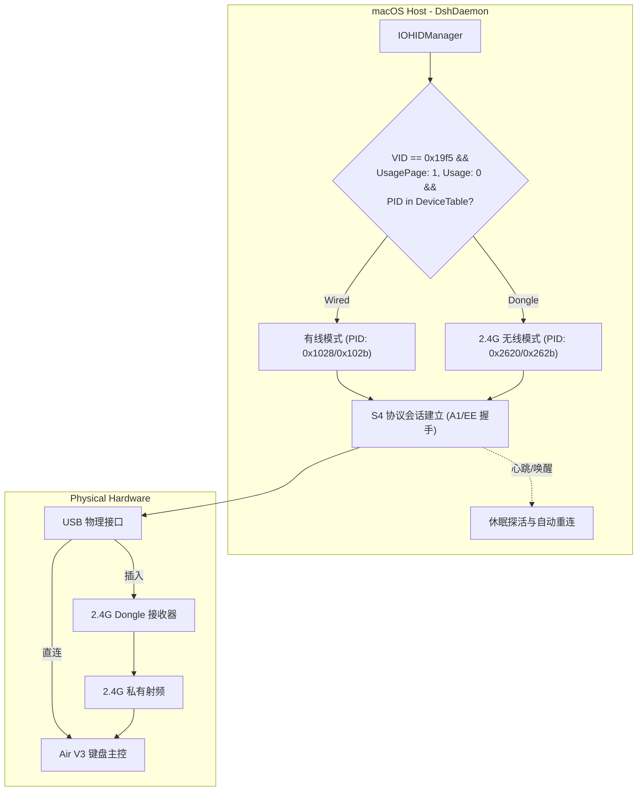
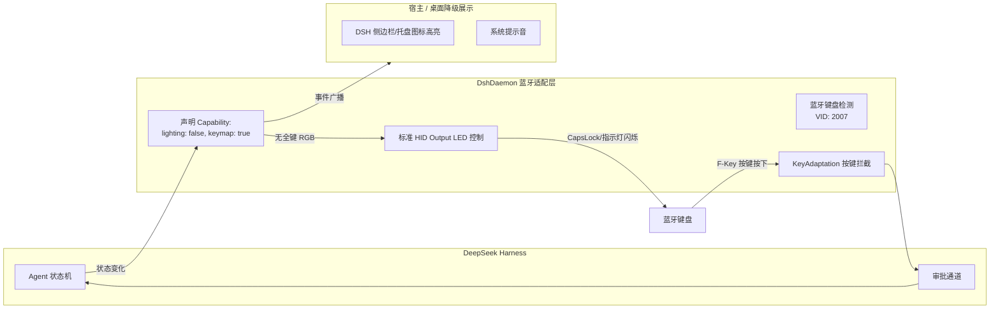

# 2.4G 与蓝牙无线多模连接通信技术方案

**文档版本**：v1.0.0  
**日期**：2026-11-03  
**状态**：设计提审 (Proposed)  
**涉及模块**：`packages/daemon` (Swift 6 Native Daemon), `packages/protocol`, `packages/server` (Cordis Plugin)

---

## 1. 背景与问题定义

DeepSeek Harness 外设协同生态（`dsh-hid`）最初以有线 USB 连接为基线进行构建，通过 Nuphy S4 协议与 64-Byte Vendor Raw HID 管道实现每键 RGB 状态矩阵流式渲染与双向按键审批交互。

在实际使用场景中，用户常将机械键盘（如 NuPhy Air V3 系列）置于无线工作模式（2.4G 接收器或蓝牙），发现当前系统**仅支持有线连接，在 2.4G 与蓝牙状态下无法进行通信**：
1. **2.4G 模式**：插上 USB 接收器并将键盘切至 2.4G 后，守护进程无法识别设备，直接抛出 `DEVICE_NOT_FOUND`（“请连接数据线，并将键盘切到有线模式”）。
2. **蓝牙模式**：系统配对蓝牙后，无法与键盘建立下行状态传输管道，全键 RGB 状态流中断。

本文基于在 macOS 宿主上的物理硬件探查、报文捕获与实机实测结果，给出 2.4G 与蓝牙无线连接的完整通信方案与降级架构。

---

## 2. 硬件探查与实测证据

### 2.1 2.4G Dongle 探查与 S4 报文验证
在 macOS 宿主通过 `IOHIDManager` 对系统 HID 节点进行全量探测，采集到当前插入的 2.4G 接收器硬件特征如下：

```text
VID: 0x19f5 (NuPhy)
PID: 0x2620 (Air75 V3 Dongle)
Product: "Air75 V3 Dongle"
Transport: "USB"
UsagePage: 1 (Generic Desktop), Usage: 0 (Undefined)
InputReportByteLength: 64
OutputReportByteLength: 64
```

* **实测分析**：
  NuPhy 2.4G 接收器本身作为 USB 从设备挂载，在 USB 层面暴露了与有线完全相同的 **64-byte Vendor Raw HID 端点**（`UsagePage: 1, Usage: 0`）。Dongle 固件在 USB 与 2.4G 专有无线射频链路之间执行透明透传（Transparent Bridge）。

* **S4 协议握手真机测试**：
  通过 Swift 构造 S4 识别帧（`0x55 0xa1 ...`）发送至 `0x19f5:0x2620`：
  ```swift
  // 发送: 0x55 0xa1 [length 8] [checksum]
  // 接收返回: aa a1 00 c1 08 00 00 00 05 00 04 aa 06 00 00 00 ...
  ```
  **验证结论**：键盘在 2.4G 无线模式下**完全支持 S4 双向通信协议**，固件具备与有线模式 100% 对等的全键 RGB 渲染与下行状态更新能力。

### 2.2 蓝牙 (BLE) 探查与通道限制
对蓝牙连接状态下的键盘节点进行系统与 CoreBluetooth 双重探测：

```text
VID: 0x07D7 (2007)
PID: 0x0000
Product: "Air75 V3-1"
Transport: "Bluetooth Low Energy"
Services: 0x400020 < HID BLE >
UsagePage: 1 (Generic Desktop), Usage: 6 (Keyboard)
InputReportByteLength: 20
OutputReportByteLength: 2
```

进一步通过 CoreBluetooth 扫描外设 GATT 服务发现：
* 暴露服务：`Device Information (0x180A)`、`Battery (0x180F)`、`Scan Parameters (0x1813)`。
* 核心 HID 服务（`0x1812`）被 macOS 蓝牙内核独占。
* **物理限制**：键盘在蓝牙模式下，为兼顾续航与操作系统原生蓝牙 HOGP（HID over GATT Profile）兼容性，**未暴露 64-byte Vendor Raw HID 管道，亦未提供私有数据透传 GATT Service**。这也是 NuPhy 官方驱动（`drive.nuphy.io`）在蓝牙下无法配置灯效的底层根本原因。

---

## 3. 2.4G 无线通信落地方案

### 3.1 根因与阻断点
当前 `packages/daemon/native/DshDaemon.swift` 中的设备匹配逻辑存在硬编码：
1. 匹配字典硬编码 `kIOHIDProductIDKey: 0x1028`（仅有线 Air75 V3 ANSI）。
2. 设备过滤中强制判定 `propertyInt($0, kIOHIDProductIDKey) == 0x1028`。
3. 报错信息强制提示“请连接数据线”。

### 3.2 改造实施方案



#### 步骤 1：扩展设备硬件标识白名单
在 `@dsh-hid/protocol` 与 `DshDaemon.swift` 中建立设备矩阵映射表：

```swift
struct NuphyDeviceProfile {
    let model: String
    let wiredPID: Int
    let donglePID: Int?
    let reportSize: Int
}

let supportedProfiles: [NuphyDeviceProfile] = [
    NuphyDeviceProfile(model: "Air75 V3 ANSI", wiredPID: 0x1028, donglePID: 0x2620, reportSize: 64),
    NuphyDeviceProfile(model: "Air65 V3 ANSI", wiredPID: 0x102b, donglePID: 0x2621, reportSize: 64),
    NuphyDeviceProfile(model: "Air96 V3 ANSI", wiredPID: 0x1029, donglePID: 0x2622, reportSize: 64),
]
```

#### 步骤 2：解耦 `IOHIDManager` 匹配条件
移除匹配字典中固定的 `kIOHIDProductIDKey`，改为通用过滤：
* `kIOHIDVendorIDKey == 0x19f5`
* `kIOHIDPrimaryUsagePageKey == 1`
* `kIOHIDPrimaryUsageKey == 0`
* 报文长度 `kIOHIDMaxInputReportSizeKey == 64 && kIOHIDMaxOutputReportSizeKey == 64`
* 在枚举结果中比对 PID 是否命中 `supportedProfiles` 中的 `wiredPID` 或 `donglePID`。

#### 步骤 3：连接态元数据扩展
在建立连接后返回的元数据中，显式声明当前连接介质：
```json
{
  "connected": true,
  "model": "Air75 V3 ANSI",
  "transport": "2.4G",
  "vendorId": 6645,
  "productId": 9760,
  "capabilities": {
    "lighting": true,
    "keymap": true,
    "wireless": true
  }
}
```

#### 步骤 4：无线休眠防抖与唤醒补偿
2.4G 键盘在空闲一段时间后射频前端会休眠（Dongle 仍在线，但下发报文会因等待键盘 ACK 超时）。
* **对策**：在 `exchange()` 逻辑中引入轻量重试：当向 2.4G Dongle 发送报告首帧超时（>500ms）时，不立即抛出异常断开连接，而是立即重发一次“唤醒前导帧”，等待 200ms 后再次读取应答。

---

## 4. 蓝牙 (Bluetooth / BLE) 连接方案

### 4.1 蓝牙现状矩阵
| 能力维度 | 蓝牙模式状态 | 底层机制 |
| --- | --- | --- |
| **物理按键上行** | **完全支持** | 走系统标准 HOGP 键盘输入通道，经过 macOS HID Event System 派发。 |
| **F-Key 审批映射** | **完全支持** | `KeyAdaptation` 已原生支持对 `VID: 2007` 蓝牙键盘进行 F13~F24 重映射与快捷拦截。 |
| **全键 RGB 状态指示** | **物理不支持** | 固件在 BLE 下未开启 64-byte Vendor Raw HID 描述符，亦无私有 GATT 通道。 |
| **键盘状态指示灯** | **理论支持** | 蓝牙 HOGP 提供了 `OutputReportByteLength: 2`（控制 CapsLock/NumLock 等 LED）。 |

### 4.2 蓝牙模式“按键保全 + 状态降级”架构



#### 策略 1：标准 HID Output Report 状态闪烁（硬件微反馈）
在蓝牙连接时，通过系统标准输出报文驱动物理键盘上的 LED（如 CapsLock 轴灯或状态指示灯）：
```swift
// Output Report [ReportID, LED_Bitmask]
// Bit 0: NumLock, Bit 1: CapsLock, Bit 2: ScrollLock
var report: [UInt8] = [0x00, 0x02] // 触发 CapsLock LED
IOHIDDeviceSetReport(device, kIOHIDReportTypeOutput, 0, &report, report.count)
```
* **状态映射**：
  * `Needs Input`（等待审批）：以 1Hz 频率脉冲闪烁 CapsLock 指示灯。
  * `Error`：快速连续闪烁 3 次。
  * `Running` / `Idle`：关闭指示灯，避免干扰正常打字。

#### 策略 2：DSH 侧边栏与桌面多感官补偿
当 Daemon 检测到仅有蓝牙连接时，向 DSH 宿主发送协议事件：
```json
{
  "jsonrpc": "2.0",
  "method": "peripheral/transportChanged",
  "params": {
    "transport": "bluetooth",
    "capabilities": {
      "rgb": false,
      "keys": true,
      "ledBlink": true
    }
  }
}
```
* **表现层降级**：
  * DSH 侧边栏常驻 UI 与 macOS 菜单栏图标承接色彩流态展示（蓝：Thinking，橙：Needs Input，绿：Done）。
  * 在状态跃迁为 `Needs Input` 时播放系统提示音（Tink/Submarine），确保用户在全屏或视线离开屏幕时仍能被提醒。
  * 物理按键（F1/F2 批准拒绝）依然直接通过蓝牙键盘秒级响应。

---

## 5. 跨模块改造影响分析

| 模块 | 影响文件 | 改动内容 | 风险级别 |
| --- | --- | --- | --- |
| **`packages/protocol`** | `src/constants.ts`<br/>`src/types.ts`<br/>`src/hid.ts` | 增加 2.4G Dongle ProductID 常量；扩展 `PeripheralDeviceCapabilities` 类型定义（`transport` 支持 `'usb' \| '2.4g' \| 'bluetooth'`）。 | 极低 |
| **`packages/daemon`** | `native/DshDaemon.swift` | 1. 扩展 `openTransport()` 中的设备匹配规则，吸纳 2.4G Dongle PID。<br/>2. 增加无线报文重试机制（抗休眠）。<br/>3. 蓝牙模式下放行按键并接入标准 HID Output LED 脉冲。 | 中 |
| **`packages/server`** | `src/router.ts`<br/>`src/service.ts` | 处理 `transportChanged` 事件，在 UI 侧正确展示无线连接介质图标（USB/2.4G/BT）及功能降级提示。 | 低 |

---

## 6. 实施排期与验证路径

1. **Phase 1（2.4G 全功能解锁，最高优先级）**：
   * 修改 `DshDaemon.swift` 设备匹配逻辑，编译输出新二进制。
   * **验证标准**：插拔 2.4G Dongle，在 2.4G 无线模式下成功执行 `identify`、读取状态、刷新全键 RGB 灯效、按键触发审批。
2. **Phase 2（蓝牙按键直通与状态降级对接）**：
   * 在纯蓝牙连接下，验证按键审批（F-Key）通道可用性。
   * 调通标准 HID Output Report 控制 CapsLock 灯效闪烁。
   * 完善 DSH 前端界面的蓝牙连接降级提示与音频同步。
